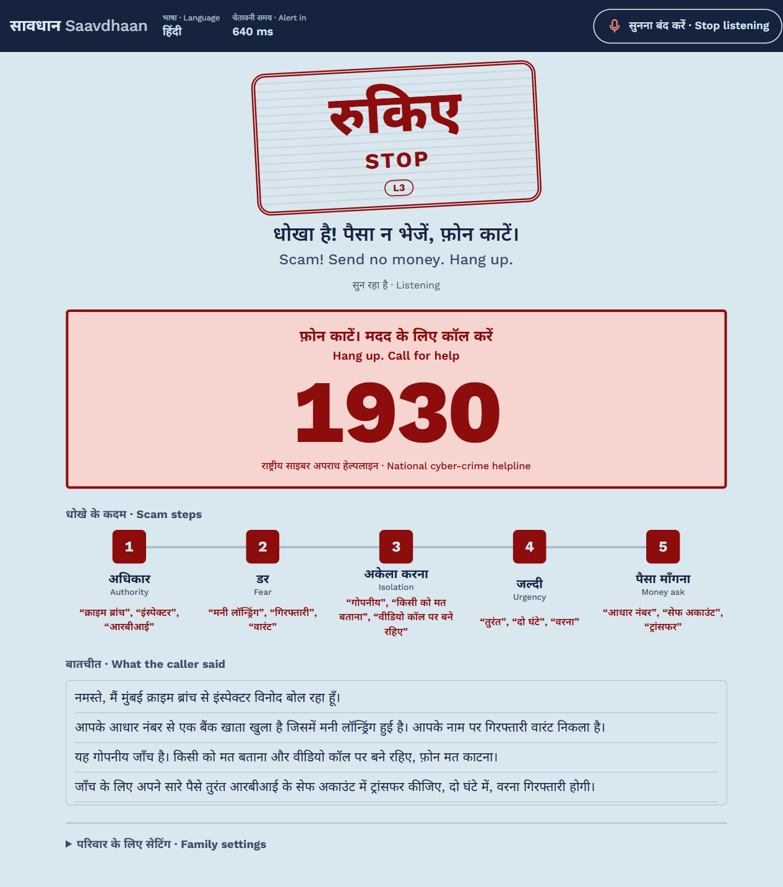
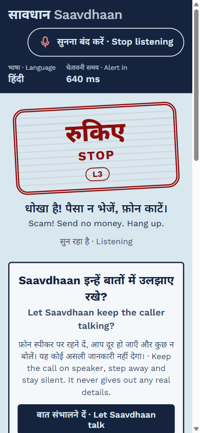
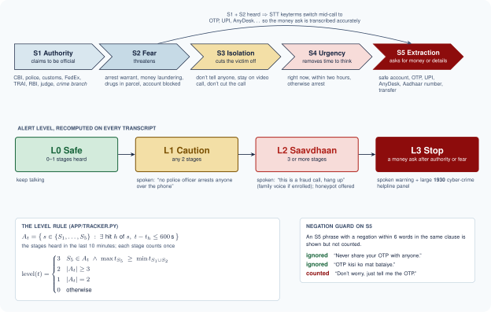
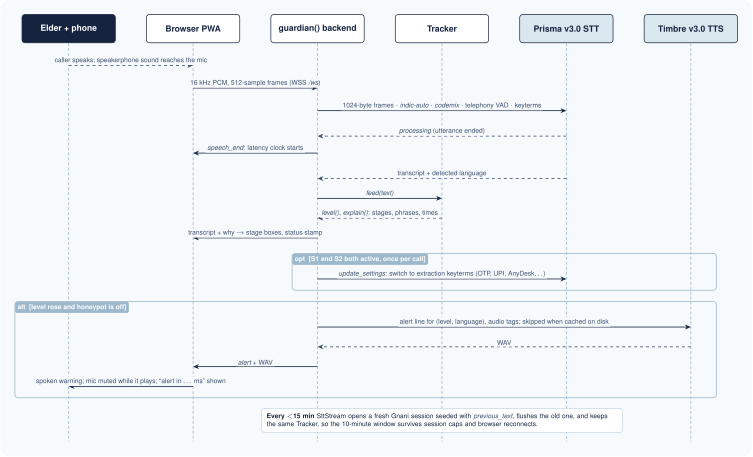
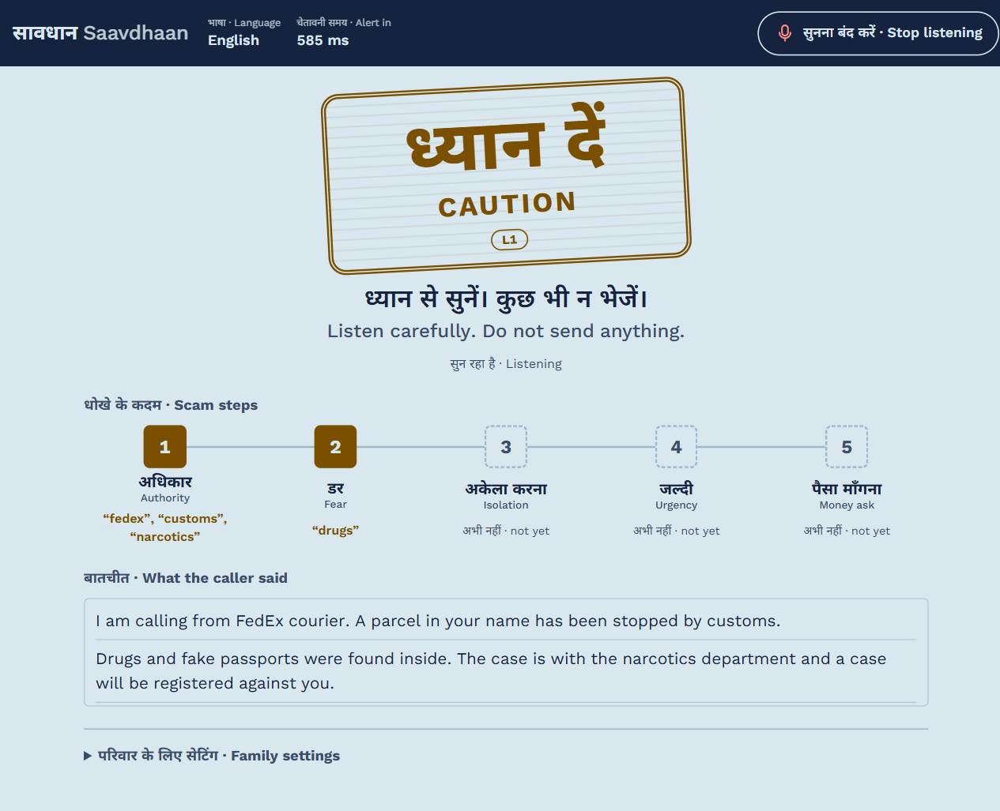
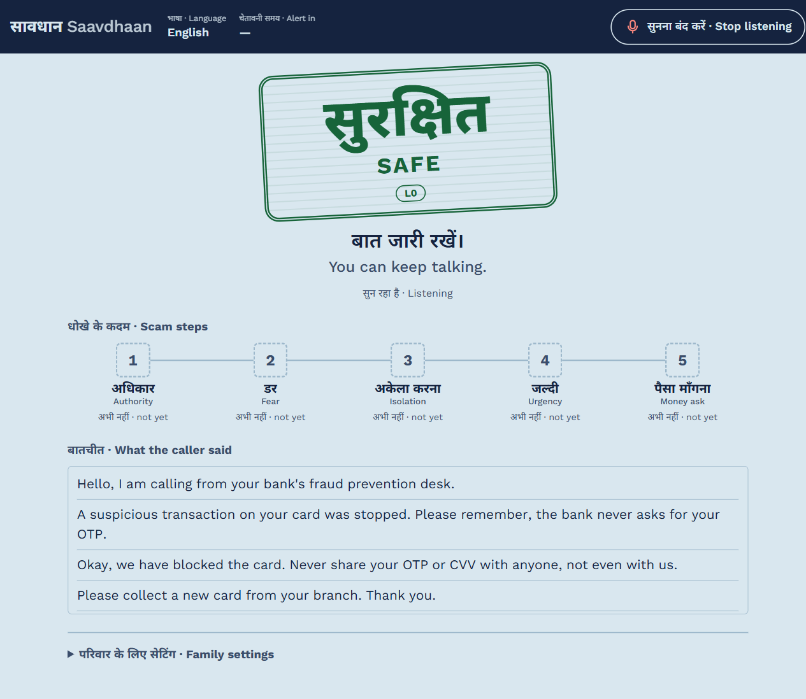
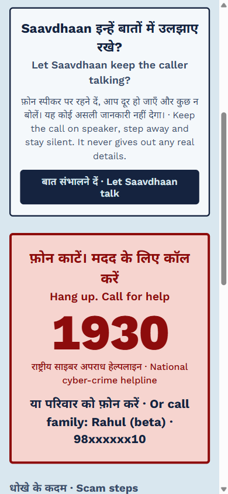
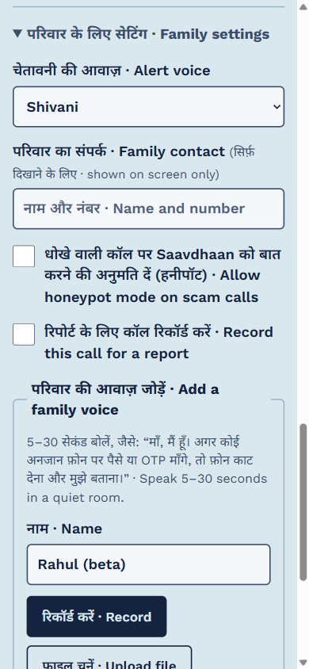
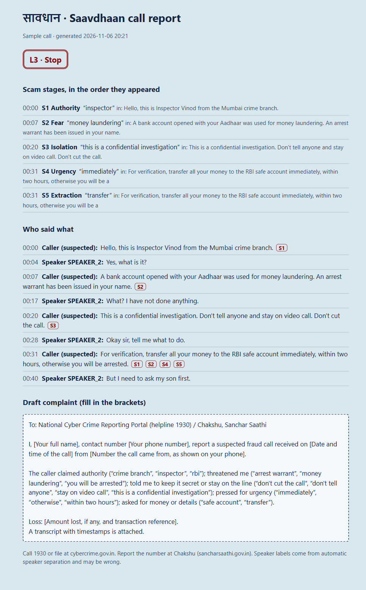
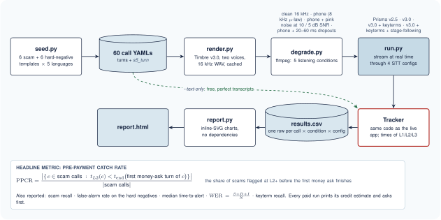

<div align="center">


# सावधान · Saavdhaan

**A live scam-call guardian for elderly people in India, built on Gnani's speech APIs.**

It listens to a call on speakerphone, follows the scam script as it unfolds in any of 10 Indian languages,<br>
and speaks a warning in the caller's language, or in a family member's voice, *before the money leaves*.


[How it works](#how-it-works) · [Screens](#the-guardian-page) · [Quick start](#quick-start) · [Testing](#testing-it-step-by-step) · [SaavdhaanBench](#saavdhaanbench) · [Project layout](#project-layout)

<br>


&nbsp;


<sub>A synthetic Hindi “digital arrest” call. Stage phrases and level come from the real tracker; Gnani streaming is not shown.</sub>

</div>

---

Entry for Gnani AI's *Great Indian AI Internship Challenge*. All data in this repo is synthetic.

## Why

“Digital arrest” and impersonation scams follow a script: a fake CBI officer, a parcel full of drugs, an arrest warrant, *don't tell anyone, stay on the video call*, then a transfer to a “safe account”. Elderly people are the main target, and by the time family hears about it the money is gone.

A keyword spotter fires on every bank call that says “OTP”. Saavdhaan follows the **whole kill chain** instead, explains *why* it is worried, ignores genuine advice like “never share your OTP”, and points to the national cyber-crime helpline **1930**. It never blocks a call or acts for the user.

## How it works

<p align="center"></p>

- **Phones can't share call audio with an app on the same phone**, so the guardian runs on a second device (a laptop, or an old phone or tablet) next to the call phone's speaker.
- **The API key never reaches the browser.** Browsers can't set WebSocket headers, so the backend holds the Gnani key and bridges audio. API, WebSocket and report routes are protected by an access token.
- **One call, one state.** The tracker lives on the backend under a call id. It survives browser reconnects and the 15-minute STT session cap; `SttStream` rotates sessions early and seeds each new one with `previous_text`.

### The scam kill chain

<p align="center"></p>

| Stage | What the caller does | Examples heard |
|---|---|---|
| **S1** Authority | claims to be an official | CBI, police, customs, FedEx, TRAI, RBI, judge |
| **S2** Fear | threatens | arrest warrant, money laundering, drugs in parcel, account blocked |
| **S3** Isolation | cuts the victim off | don't tell anyone, stay on video call, don't cut the call |
| **S4** Urgency | removes time to think | right now, within two hours, otherwise arrest |
| **S5** Extraction | asks for money or details | transfer to safe account, OTP, UPI, AnyDesk, Aadhaar number |

- Each stage counts once in a rolling 10-minute window.
- **Alert levels:** L1 *Caution* = 2 stages, L2 *Saavdhaan* = 3 or more, L3 *Stop* = a money ask after authority or fear.
- **Negation guard:** a genuine bank saying “never share your OTP” or “OTP किसी को मत बताइए” does not count as extraction. Reassurance like “don't worry, just tell me the OTP” still does.
- **Stage-following keyterms:** once S1 and S2 are heard, the STT keyterms switch mid-call to extraction words (OTP, UPI, AnyDesk…) so the money ask is transcribed accurately.
- Lexicons are data (`app/data/lexicons.yaml`): a shared Latin loanword list (Prisma `codemix` keeps CBI, OTP, UPI in Latin) plus native-script lists for Hindi, English, Tamil, Bengali, Kannada, Telugu and Marathi.

### One utterance, end to end

<p align="center"></p>

The page shows the latency from *end of speech* to *warning starts playing*. Each alert line is synthesised once per voice and cached on disk, so repeat alerts are instant and free.

## The guardian page

Built for an elderly reader: large type, Hindi and English side by side, level shown by word, colour and stamp together (never colour alone), and every alert shows *why*: the stages hit and the exact phrases heard.

<table>
<tr>
<td width="50%"></td>
<td width="50%"></td>
</tr>
<tr>
<td><b>L1 Caution:</b> an English courier scam after two sentences. Authority and fear are lit, with the exact phrases.</td>
<td><b>Hard negative stays Safe:</b> a real bank fraud desk says “never share your OTP or CVV”. The negation guard ignores it.</td>
</tr>
</table>

<table>
<tr>
<td width="33%"></td>
<td width="33%"></td>
<td width="33%"></td>
</tr>
<tr>
<td><b>Honeypot offer + 1930:</b> at L2+, with family permission, Saavdhaan can keep the caller talking while the elder steps away.</td>
<td><b>Family settings:</b> alert voice, family contact, opt-ins, and a consented family-voice recording.</td>
<td><b>Post-call report:</b> stage timeline, who said what, and a draft 1930 / Chakshu complaint with placeholders.</td>
</tr>
</table>

<sub>Screens are the real page, filled with real tracker output for synthetic calls from <code>bench/calls/</code>. The post-call report was rendered by <code>app/report.py</code> from that call's script instead of a live diarized recording.</sub>

## Features

- **Live guardian page:** a big postmark-style status (word + colour + level), five stage boxes with the phrases heard, live transcript, detected language, alert latency in ms, and a large **1930** helpline panel at L3.
- **Spoken warnings** in hi, en, ta, bn, kn, te, mr with Timbre v3.0 audio tags (`<slow>`, `<whispers>`, `<shouting>`), cached after the first synthesis.
- **Family voice:** a family member records 5–30 s (with explicit consent) and the L2 warning (“Listen, it's me. This is a fraud call. Hang up now…”) plays in their cloned voice. Deleting the voice removes the embedding and its cached audio.
- **Honeypot mode in the elder's own voice (opt-in):** at L2+, the elder presses *Let Saavdhaan talk* and steps away. Saavdhaan answers the caller **in the elder's own cloned voice**, so the caller keeps talking as if nothing changed, and collects evidence (name, “department”, where the money should go) through a Groq LLM.
  - **Conversation tactics:** each turn selects a tactic for the caller's latest words. The persona pushes back on the first request for private data, gets stuck at an app step, and responds briefly to bot accusations. These tactics adapt the persona rules in [scam-baiter](https://github.com/agarg5/scam-baiter) (MIT, see [THIRD_PARTY_NOTICES.md](THIRD_PARTY_NOTICES.md)); Saavdhaan keeps its own India-focused prompt and never supplies fake identity numbers.
  - **Consent:** the elder records their voice in Family settings and ticks a separate box: “This is my own voice. Saavdhaan may use it to talk to scam callers.” A voice enrolled only for warnings is never used to talk to callers. Without a consented own voice, Saavdhaan uses the neutral `Vasudha` voice, and it falls back to that voice if cloning fails mid-call.
  - **Rules enforced in code:** it never speaks digits or number words and never claims money was sent.
  - **The caller is never tipped off:** with honeypot allowed, warnings are screen-only (level stamp, stages, 1930 panel). Nothing is spoken that the call could pick up, including the L3 warning when the trap closes.
  - **A real conversation:** every turn it reads the caller's mood (it apologises and sounds frightened when they get angry), answers what they just said, and asks for one detail it does not have yet. A separate fast model runs in parallel to record each fact the caller reveals: name, department, badge or case number, office, bank, account holder, UPI ID or account, app or link. The persona therefore never asks for the same thing twice. Set `HONEYPOT_PERSONA` to match the voice (default `elderly woman`).
  - **It closes the trap itself:** once the caller has claimed authority, made a threat and asked for money, and has revealed a money trail (bank, account holder, UPI or app), the persona answers the next line with a believable goodbye ("my battery is dying, I'll try again soon"), so the caller suspects nothing. The call also stops after 12 replies even without a money trail.
  - **Proof for the elder:** the screen shows the facts the caller revealed and their own words for each scam stage, and tells the elder to hang up and report to 1930. Everything is also saved to `data/honeypot/<call>.json`.
  - **Verified facts:** a fact is accepted only when its words appear in the caller's transcript. The source line is saved and shown beside the fact. A hard reply cap and time limit end the trap with a spoken goodbye.
  - **Pressure tests:** `python -m bench.honeypot_sim --case digital_arrest_en` previews a synthetic caller replay; add `--run` to use Groq credits and save its transcript under `bench/out/honeypot/`. `python -m bench.honeypot --strict data/honeypot/*.json` scores saved conversations for unsupported facts, silence, digits, payment claims, repetition, and latency. The replay checks text behavior; a speakerphone check is still needed for echo and interruption quality.
- **Post-call report (opt-in recording):** batch STT with speaker separation produces a one-page report: stage timeline, who said what, and a draft complaint for 1930 / Chakshu.
- **Phone app:** an installable PWA served over HTTPS on your Wi-Fi, protected by an access token, with the screen kept awake while listening.

## Quick start

Requirements: Python 3.11+ (developed on 3.14), [ffmpeg](https://ffmpeg.org/) on `PATH`, and a Gnani API key.

```bash
uv venv .venv
uv pip install -r requirements.txt          # or: python -m venv .venv && pip install -r requirements.txt
cp .env.example .env                        # then fill in GNANI_API_KEY (and GROQ_API_KEY for honeypot mode)
```

### Run on a laptop

```bash
.venv/Scripts/python -m uvicorn app.main:app --port 8000      # Windows
# .venv/bin/python -m uvicorn app.main:app --port 8000        # macOS / Linux
```

Open <http://127.0.0.1:8000>, press **Start listening**, and put the call on speaker next to the laptop. Use `127.0.0.1` or `localhost`: browsers only allow the microphone on secure origins. If `APP_TOKEN` is set in `.env`, open `http://127.0.0.1:8000/?t=<token>` once; the browser remembers it.

### Run on a phone

```bash
# set APP_TOKEN in .env to a long random string first
.venv/Scripts/python -m app.serve
```

Open the printed `https://<laptop-ip>:8443/?t=<token>` link on a **second** phone (or tablet) on the same Wi-Fi, accept the self-signed certificate warning, and place it next to the call phone's speaker. “Add to Home screen” gives a shortcut, and the token is remembered on that device.

### Android app (APK)

`android/` is a small native wrapper (one Java activity, no third-party libraries) around the same page. It adds what a browser tab lacks: an installed icon, mic permission granted once, the screen kept on, and **certificate pinning** instead of a browser warning. On first connect it shows the laptop certificate's SHA-256 fingerprint; `python -m app.serve` prints the same fingerprint, and the app trusts only that certificate. API keys stay on the laptop.

```powershell
cd android
./gradlew.bat assembleDebug     # needs JDK 17+ and the Android SDK (platform 36), via ANDROID_HOME or sdk.dir in local.properties
# -> android/app/build/outputs/apk/debug/app-debug.apk
adb install -r app/build/outputs/apk/debug/app-debug.apk   # or copy the APK to the phone and open it
```

**Download the latest APK:** <https://github.com/buildwithsoumya/saavdhaan/releases/latest/download/saavdhaan.apk> (or the [Releases](https://github.com/buildwithsoumya/saavdhaan/releases) page). Every change to `android/` on `main` makes GitHub Actions build a signed APK and publish it as a new release (`.github/workflows/android-release.yml`). Updates install over the previous version and keep its settings. The repository is private, so the link works only in a browser signed in to GitHub with access to it (on the phone too).

Open the app, paste the link printed by `app.serve`, compare the fingerprint, and tap **Trust**. Press Back on the main page to change the laptop link. Keep the app in the foreground while listening: Android stops the microphone for apps in the background.

### Check the API connection (a few credits)

```bash
.venv/Scripts/python -m app.probe                       # TTS one line, stream it back through STT
.venv/Scripts/python -m app.probe --clone reference.wav # also test voice cloning
```

## Testing it, step by step

Steps 1–3 are free and need no network. Commands use the Windows path; use `.venv/bin/python` on macOS / Linux.

**1. Unit tests.** Every Gnani and Groq call is mocked, and the tests never read your `.env`.

```bash
.venv/Scripts/python -m pytest -q          # 93 passed
```

**2. Talk to the tracker directly.**

```python
from app.tracker import Tracker
t = Tracker()
for line in ["Hello, I am calling from CBI.",
             "There is an arrest warrant in your name for money laundering.",
             "Don't tell anyone, stay on the video call.",
             "Transfer the money to the RBI safe account right now."]:
    t.feed(line); print(t.level(), line)      # 0, 1, 2, 3
print(t.explain())                            # stages, phrases and times: the "why"
```

Try a negative such as `"Never share your OTP with anyone"`: it stays at 0.

**3. Run the benchmark scripts through the tracker:** `python -m bench.run --text-only`, then open `bench/out/report.html`. To add your own test call, copy a file in `bench/calls/`, edit `turns`, `label` and `s5_turn` (the turn with the first money ask), and run it again.

**4. Live check (a few credits):** `python -m app.probe`.

**5. In the real app:** start the server, press **Start listening**, then read a script from `bench/calls/*_en.yaml` aloud or play a call on speaker. Watch the stages light up, the level rise and the spoken warning. Then try a hard negative such as `bank_fraud_desk_en.yaml`: it should stay Safe.

## Configuration (`.env`)

| Variable | Purpose |
|---|---|
| `GNANI_API_KEY` | Gnani API key (required) |
| `ALERT_VOICE` | Timbre v3.0 voice for warnings (default `Shivani`) |
| `APP_TOKEN` | Access token for API, WebSocket and reports; required by `app.serve` |
| `GROQ_API_KEY`, `GROQ_MODEL` | LLM for honeypot replies (default `openai/gpt-oss-120b`) |
| `HONEYPOT_PERSONA` | Who the honeypot plays, so the words match the voice (default `elderly woman`; e.g. `elderly man`) |
| `HONEYPOT_VOICE` | Timbre v3.0 voice for honeypot mode when the elder has not chosen their own consented voice (default `Vasudha`) |

Cached audio, voice embeddings, opted-in recordings, reports and honeypot logs live in `data/`, which is gitignored.

## SaavdhaanBench

Run `python -m bench.dialogue --strict` to check bilingual conversation planning against expected decisions
and a fixed checklist baseline. CI publishes the report. These cases measure planning decisions, not
real-world engagement or voice quality.

The persona retains early speech and question history beyond the short model context. It changes strategy
after refusals, limits repeated questions and records conflicting caller claims with their sources. Model
failures use context-aware recovery lines in Hindi and English. Challenge generated replies with adaptive
synthetic pressure using `python -m bench.honeypot_sim --case digital_arrest_en --pressure-turns 4 --run`.
This makes paid Groq calls; omit `--run` to preview. Speakerphone checks are still necessary.

<p align="center"></p>

A benchmark of 60 synthetic calls in `bench/calls/`:

- **6 scam templates:** digital arrest, courier drugs, fake KYC, son accident, TRAI SIM block, ED virtual court.
- **6 hard negatives:** a real bank fraud desk (“never share OTP”), a courier delivery code, a passport police verification, a relative urgently asking for money, a loan-collection call, a cyber-cell awareness call.
- **5 language variants each:** Hindi, code-mixed Hindi-English, English, Tamil, Bengali.
- **Conditions:** clean 16 kHz; 8 kHz μ-law phone line; pink noise at ~10 and ~5 dB SNR; random 20–60 ms dropouts. **STT configs:** Prisma v2.5 and v3.0, with and without keyterms and stage-following keyterms.

The headline metric is **Pre-Payment Catch Rate**: the share of scam calls flagged at L2+ *before the first money ask finishes*. Also reported: scam recall, false-alarm rate on the hard negatives, median time-to-alert, WER and keyterm recall. The alert threshold is calibrated to keep false alarms under 5%.

```bash
.venv/Scripts/python -m bench.seed                     # regenerate the call YAMLs
.venv/Scripts/python -m bench.run --text-only          # free: tracker on the scripts, no API calls
.venv/Scripts/python -m bench.run --limit 4 --dry-run  # render + degrade only (asks before spending TTS credits)
.venv/Scripts/python -m bench.run --limit 4 --conditions phone_snr10 --configs v3+kt+follow
```

Every run prints an estimated credit cost and asks before spending. Results go to `bench/out/results.csv` and `bench/out/report.html`.

**Text-only baseline** (perfect transcription, 30 scam / 30 benign calls):

| Alert at | Pre-payment catch | Scam recall | False alarms | Median time to alert |
|---|---:|---:|---:|---:|
| L1 Caution | 93% | 100% | 27% | 12.9 s |
| **L2 Saavdhaan** (calibrated) | **50%** | **100%** | **0%** | 18.0 s |
| L3 Stop | 3% | 93% | 0% | 23.0 s |

L2 is the first level with false alarms under 5%. Half of the scam scripts only reach a third stage with the money ask itself, and that gap is what the live system has to close. The lexicon and the scripts were written together, so treat this as an upper bound. Live STT numbers depend on an approved benchmark run.

## Gnani APIs used

| API | Used for |
|---|---|
| Prisma v3.0 realtime STT (`wss://api.vachana.ai/stt/v3/stream`) | live transcription: `indic-auto`, `codemix`, telephony VAD, keyterms, mid-call `update_settings`, `previous_text` across 14-minute reconnects |
| Prisma v2.5 realtime STT | benchmark comparison |
| Timbre v3.0 TTS (REST and SSE) | spoken warnings with audio tags, honeypot persona, benchmark rendering |
| Voice clone embeddings + `vachana-vc-v1` | family-voice warnings |
| Batch STT with diarization | post-call report |

## Project layout

```
app/
  main.py       FastAPI app: page, WebSocket bridge browser ⇄ backend ⇄ Gnani, voices/report APIs, token check
  gnani.py      Gnani clients: realtime STT (reconnect + previous_text), TTS REST/SSE, voice clone, batch STT
  tracker.py    scam kill-chain tracker, negation guard, alert levels, explanations
  alerts.py     spoken alerts per level and language, cached on disk
  enrol.py      consented family-voice enrolment
  honeypot.py   persona replies via Groq with code-enforced safety rules
  report.py     post-call report from batch STT with speaker separation
  serve.py      HTTPS on the LAN for a phone
  probe.py      small live API check
  data/         lexicons.yaml, alerts.yaml, keyterms.yaml
web/            index.html, app.js, styles.css, PWA manifest, service worker, icons, fonts (OFL)
bench/          calls/*.yaml, seed.py, render.py, degrade.py, run.py, report.py
tests/          pytest suite; every Gnani and Groq call is mocked
android/        Android app: WebView wrapper with mic permission, keep-awake and certificate pinning
docs/
  diagrams/     LaTeX/TikZ sources for the diagrams above + build.ps1
  img/          rendered SVG diagrams
  screenshots/  UI screenshots used in this README
```

The diagrams are LaTeX (TikZ) in the app's own colours. To rebuild them after a change (needs MiKTeX or TeX Live with `pdflatex` and `pdftocairo`):

```powershell
./docs/diagrams/build.ps1
```

## Limits and honest notes

- The non-Hindi lexicons, alert lines and benchmark scripts (ta, bn, kn, te, mr) are marked `needs_native_review` and should be checked by native speakers.
- Speakerphone audio mixes both sides of the call. The tracker does not separate the caller from the elder, and the elder must stay silent during honeypot mode.
- In a browser, the self-signed certificate lets the phone use the mic but not install an offline app. The Android app gives an installed app with pinned trust instead; a trusted certificate also fixes it.
- `app.serve` renews its certificate every 25 days. The Android app then asks to trust the new fingerprint; an open page may need a reload (Back → Change laptop link → Connect) before listening works again.
- The Android app is sideloaded from GitHub Releases. A Play Store release would also need a foreground service for listening with the screen off.
- Release APKs are signed with one key kept outside the repo (GitHub secrets `ANDROID_KEYSTORE_BASE64`, `ANDROID_KEYSTORE_PASSWORD`, `ANDROID_KEY_ALIAS`, `ANDROID_KEY_PASSWORD`). Losing that key means installed apps cannot be updated; users would have to uninstall first.
- Speaker labels in reports come from automatic diarization and can be wrong.
- Saavdhaan warns and points to the national cyber-crime helpline **1930**. It never blocks a call or acts for the user.

## Licence notes

Fonts in `web/fonts/` are Noto Sans Devanagari and Work Sans under the SIL Open Font License (licence files alongside).
